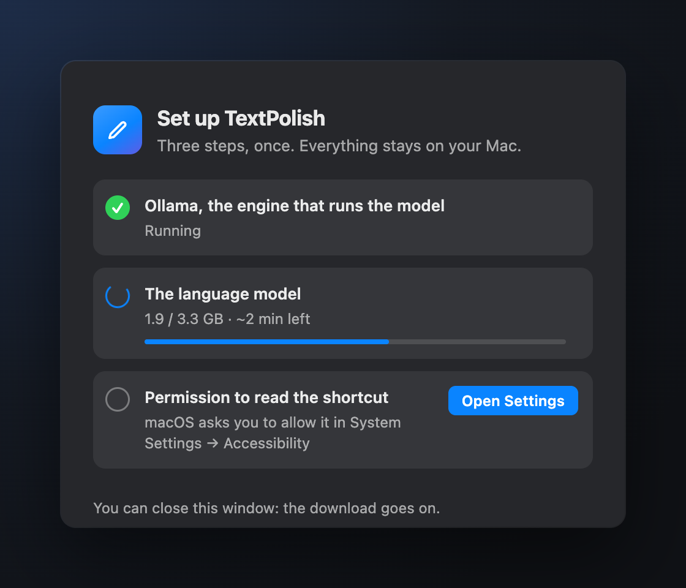

# TextPolish


> **In short**
> - **What:** a Mac tool that fixes the text you select, with an AI model running on your Mac. It is built on two sides: the **interface** (a popup that adapts to the text and lets you accept or ignore each fix) and the **mechanism behind it** (a model chosen by benchmark, safety rules, a grammar checker).
> - **Key number:** 95 % of new sentences come out right the first time, and a fix the app isn't sure about is never applied without your click.
> - **What it shows:** a personal learning project in product design *and* engineering: 17 models benchmarked, test sets frozen before each change, every failure classified as grave, minor or missed.

Select text in any app, press ⌥⌘G, review the fixes, and the text is pasted back. Everything runs on your Mac: it works offline once installed, with no account, and your text is never sent anywhere. The demo below is the real app, filmed by `design/record_video.py` and edited with Remotion (`video/`).

<p align="center">
  
</p>

<p align="center"><b><a href="https://enguerrand-roques.github.io/textpolish/textpolish-demo.mp4">▶ Watch the 1-minute video</a></b> — real recordings of the app in English, then the switch to French; only the typing is sped up, and the on-screen stopwatch shows the real model time (made with <a href="video/">Remotion</a>).</p>

→ **[Read the UX case study](https://enguerrand-roques.github.io/textpolish/case-study.html)** (design process, iterations, real-use testing) · **[Project website](https://enguerrand-roques.github.io/textpolish/)** · every popup state: [light](docs/screenshots/all-states-light.png) / [dark](docs/screenshots/all-states-dark.png) · [what changed in each version](CHANGELOG.md)

> **About this project.** A personal project: an AI product built end to end, and measured like one. What it shows:
> - **Product and UX:** a popup that adapts to the text, three modes, English and French, a guided setup, eleven iterations ([case study](https://enguerrand-roques.github.io/textpolish/case-study.html)).
> - **A model chosen by measurement:** 17 local models benchmarked against expected answers ([report](benchmarks/BENCHMARK_REPORT.md)).
> - **Safety over coverage:** a wrong fix is worse than a missed one, so doubtful fixes wait for a click, and every failure is classified as grave, minor or missed with a rubric written first.
> - **Rigorous evaluation:** 802 test sentences, and three held-out sets each committed before the change it judges, so the scores can't be tuned to the test.
> - **AI and rules together:** the model, a review layer, then LanguageTool's grammar rules, each measured on its own.

> **Built for macOS.** The popup, the menu bar icon, the screenshots and every real-app test are macOS (Apple Silicon, tested on an M2 with 16 GB); the unit tests also run on Linux CI. A lighter Windows version is included as an experiment.

> **Prefer a cloud version?** [TextPolish Cloud](https://github.com/Enguerrand-Roques/textpolish-cloud) is the same tool with Google Gemini: no local model, a free API key.

---

## Features

| Feature | Description |
|---------|-------------|
| **Three modes** | Correction (fixes mistakes only, default), Pro (⌘2, professional rewrite), Custom (⌘3, your own request: translate, shorten, warmer…) |
| **English and French** | Corrects and rewrites both languages (tested on English and French sets). The interface is in English or French: switch from the menu bar icon → Language, it is remembered |
| **Every fix explained** | Each correction is labeled: spelling, accent, capitalization, punctuation, agreement, conjugation, grammar (including homophones like their/there) or rewrite. Short texts get one card per fix, long ones a highlighted document |
| **Safe by default** | A fix that isn't a known kind of mistake (a rewording, removed punctuation, an informal word…) is shown with an orange "Check" and only applied if you click it |
| **Grammar rules on top of the model** | Optional: LanguageTool, a rule-based checker, runs locally after the model and fixes the grammar it knows by rule (~15 ms) |
| **Correction history** | Last 10 corrections in the menu bar icon → History. Click an entry to copy the corrected text |
| **Configurable shortcut** (macOS only) | Change the keyboard shortcut live from the menu bar icon → Preferences… (Cmd+,) — no restart needed. On Windows, edit `SHORTCUT` in `config.py` and restart the app |
| **Native-feeling popup** (macOS) | Opens under the selection with macOS vibrancy, light and dark mode, full keyboard control (↵ ⇥ ⌘↵ ⌘1-3 esc) |
| **Works everywhere** | Any app where you can select text: Mail, Slack, Notion, VS Code… The popup stays above fullscreen apps |

---

## Installation

**One command** (macOS 13+, Apple Silicon recommended). Paste it in Terminal:

```bash
curl -fsSL https://raw.githubusercontent.com/Enguerrand-Roques/textpolish/main/install.sh | bash
```

What the command does, in order:

1. Installs a recent Python if yours is too old (through [uv](https://docs.astral.sh/uv/), no Homebrew needed).
2. Installs [Ollama](https://ollama.com), the engine that runs the model, if it isn't there.
3. Downloads the latest TextPolish into `~/Library/Application Support/TextPolish` and puts **TextPolish.app** on your Desktop.
4. Installs LanguageTool, the optional grammar checker, if you have Homebrew.
5. Opens TextPolish.

About 10 seconds when Python and Ollama are already there. Nothing asks for an administrator password, and you can [read the script](install.sh) before running it.

On first launch, a setup window checks the three things TextPolish needs and fixes each with one button:

| Step | What happens |
|---|---|
| Ollama running | started automatically |
| The model (4.3 GB, once) | **Download** button, progress bar and time left; you can close the window, it goes on; an interrupted download resumes |
| Accessibility permission | **Open Settings** button; the step turns green as soon as you switch it on, and the shortcut starts working without a restart |

<p align="center"></p>

Then select text in any app and press **⌥⌘G**.

### If something goes wrong

| Problem | Fix |
|---------|-----|
| The setup window shows a step in red | Its message says why (no network, disk full: 5 GB free needed); the button retries, and a download resumes where it stopped |
| The shortcut does nothing | The Accessibility permission is off. Quit and reopen TextPolish: the setup window comes back whenever something is missing. Or turn it on in System Settings → Privacy & Security → Accessibility |
| Text not pasted back | Keep the app you were writing in focused until the popup closes |
| Slow first correction | Normal after 5 minutes idle: the model reloads (3–6 s). Raise `OLLAMA_KEEP_ALIVE` in `config.py` to keep it loaded longer |
| High RAM after use | Lower `OLLAMA_KEEP_ALIVE` (0 frees the 4.3 GB at once, but every request then waits 3–6 s) |
| Anything else | `~/Library/Logs/TextPolish/textpolish.log` |

To start TextPolish when you log in: in `~/Library/LaunchAgents/com.user.textpolish.plist` set `RunAtLoad` to `<true/>`, then run `launchctl bootout gui/$(id -u)/com.user.textpolish && launchctl bootstrap gui/$(id -u) ~/Library/LaunchAgents/com.user.textpolish.plist`.

<details>
<summary><strong>Other ways to install: by hand on macOS, or Windows (experimental)</strong></summary>

**By hand on macOS** (Python 3.10+ and Ollama 0.40+ already installed):

```bash
git clone https://github.com/Enguerrand-Roques/textpolish.git && cd textpolish
bash setup.sh                    # venv, config.py, TextPolish.app on your Desktop
ollama pull gemma4:e2b-it-qat    # the model, 4.3 GB, once
brew install languagetool        # optional grammar checker
```

Then open **TextPolish.app** on your Desktop.

**Windows** (experimental, untested since the redesign; Python 3.11+ and Ollama installed):

```bat
git clone https://github.com/Enguerrand-Roques/textpolish.git && cd textpolish
python -m venv venv && venv\Scripts\activate
pip install -r requirements-windows.txt && copy config.example.py config.py
ollama pull gemma4:e2b-it-qat
python main.py
```

A ✏️ icon appears in the system tray; the shortcut is **Ctrl+Alt+G**. The Windows version has a simpler window, no setup window and no LanguageTool pass.

</details>

---

## Configuration

Edit `config.py` (excluded from Git — never committed):

```python
OLLAMA_BASE_URL     = "http://localhost:11434"
OLLAMA_MODEL_CASUAL = "gemma4:e2b-it-qat"   # Correction
OLLAMA_MODEL_PRO    = "gemma4:e2b-it-qat"   # Pro
OLLAMA_MODEL        = "gemma4:e2b-it-qat"   # Custom (your own request)
OLLAMA_TIMEOUT      = 60
OLLAMA_KEEP_ALIVE   = 300
UI_LANGUAGE         = "en"                # "en" or "fr", also from the menu bar icon → Language
SHORTCUT            = "<cmd>+<alt>+g"     # macOS: Cmd+Option+G, Windows: Ctrl+Alt+G
```

---

## Speed

Measured on an M2 with 16 GB:

| | Warm (model in RAM) | Cold (model not loaded) |
|---|---:|---:|
| Short sentence, any mode | 0.5–1.1 s | 3–6 s |
| 338-character report (Correction) | 2.7 s | — |
| ~370-character message, 11–13 mistakes (demo video, EN and FR) | 3–4 s | — |
| ~1,500 characters (Correction) | ~10 s | — |

Time grows with the length of the answer (about 30–35 tokens per second). The 4,000-character input limit stays under the 60 s timeout.

Cold happens on the first request and again after 5 minutes without use (`OLLAMA_KEEP_ALIVE = 300` frees the 4.3 GB of RAM). Right after a reboot, when macOS has not cached the model file yet, the first request took 9–15 s. Raise `OLLAMA_KEEP_ALIVE` if you prefer speed over free RAM.

---

## Project Structure

```
textpolish/
├── main.py              # Entry point — detects OS, loads the right backend
├── clipboard.py         # Copy / paste logic          ─┐
├── llm.py               # Ollama request layer         │
├── languagetool.py      # Optional rule-based 2nd pass │
├── diff.py              # Groups and labels fixes      │
├── i18n.py              # English / French strings     ├─ shared across platforms
├── language.py          # French or English, no model  │
├── history.py           # Correction history           │
├── polish_job.py        # Correction threading         │
├── prompts/             # Prompt templates            ─┘
├── config.example.py
├── install.sh           # One-command install: Python, Ollama, latest release
├── setup.sh             # Venv, config, LaunchAgent, TextPolish.app
├── setup_check.py       # First-launch checks and the model download
│
├── platforms/
│   ├── macos/           # PyObjC · NSPanel · WKWebView · CGEventTap
│   │   ├── ui.py        # Menu bar item, panel, JS bridge
│   │   ├── panel.html   # The popup: cards, document view, rewrite (HTML/CSS/JS)
│   │   ├── ax_bounds.py # Where the selection is on screen (Accessibility API)
│   │   ├── spelling.py  # macOS dictionary: real word or typo (review rules)
│   │   ├── onboarding.py / .html  # First-launch setup window
│   │   ├── hotkey.py
│   │   ├── shortcut_parser.py
│   │   └── main.py
│   └── windows/         # PyQt6 · QSystemTrayIcon · pynput (experimental)
│
├── tests/               # pytest, runs on Linux CI (macOS APIs are stubbed)
├── benchmarks/          # Model research: report, harness, every raw output
├── design/              # Dev tools: model eval, real-app timing, previews, recordings
├── video/               # Remotion project that edits the demo video
└── docs/                # GitHub Pages: landing page, UX case study, media
```

---

## How models were chosen

TextPolish uses one local model, `gemma4:e2b-it-qat`, for all three modes. That choice comes from six benchmark rounds and 17 models tested on an Apple M2 16 GB (full list in the [benchmark report](benchmarks/BENCHMARK_REPORT.md#summary--17-models-10-rounds-april--november-2026)).

**Current configuration:** one model, `gemma4:e2b-it-qat`, for the three modes.

| Mode | Tested on | How it is scored | Result | Warm | Cold |
|------|-----------|------------------|-------:|-----:|-----:|
| Correction | 174 sentences never seen before (86 FR, 88 EN) | the fix must match an expected answer | **165 / 174** (95 %) | 0.9 s | 5.0 s |
| Pro | 50 messages (25 FR, 25 EN) | automatic checks: the facts are kept (names, days, times, amounts), no invented greeting, sign-off or placeholder, right language | **48 / 50**, every fact kept | 0.9 s | 3.4 s |
| Custom | 30 requests (15 FR, 15 EN) | the request is met (translated, shorter, a list, one sentence, "vous"…) and the facts are kept | **29 / 30** | 0.8 s | 3.1 s |

Correction is tested on 802 sentences with held-out sets frozen before each change. Pro and Custom are checked for what matters in a rewrite: no fact lost, nothing invented, the request met. Every result, failures included, is in the [report](benchmarks/BENCHMARK_REPORT.md).

Warm = median per sentence with the model in RAM. Cold = `ollama stop`, then one request, median of 3 runs (range 3.0–6.3 s); the model file was still in macOS's file cache, so a first request after a reboot is slower (9–15 s observed).

Key findings that shaped this choice:

- **One model beats two.** With a Correction model and a Pro model, every mode switch reloaded a model (~5 s on 16 GB). With one model, switching modes adds no wait (0.75–0.8 s for a sentence in Pro).
- **Gemma 4 E2B matches the previous Correction model and is better at Pro and Custom.** `gemma3:4b` added "Dear [Recipient Name]" placeholders and once reversed the meaning of a sentence; `ministral-3:3b` answered a message instead of rewriting it.
- **Hybrid-reasoning models need `"think": false`.** Gemma 4, Qwen 3.5 and LFM3 think by default on Ollama; without it a 1 s correction takes tens of seconds. LFM3 still printed its reasoning into the answer and was dropped.
- **MLX is faster but heavier.** Ollama 0.40 runs `gemma4:e2b-nvfp4` on Apple's MLX engine: 0.34 s per correction, but ~7.4 GB in RAM, which pushed this 16 GB Mac into swap. It is the better choice on 24 GB or more.
- **A rule-based checker catches what the model misses.** LanguageTool runs locally after the model and fixes the grammar it knows by rule ("quand au" → "quant au", "have ate" → "have eaten"); only single-suggestion grammar rules are applied, and the French rules that "fix" informal register ("j'ai pas" → "je n'ai pas") are off. On unseen sentences it brought English to 86 of 88 and French to 79 of 86, for ~15 ms per correction.
- **Safe by default.** A missed mistake leaves your text as written; a wrong fix changes what you meant. Fixes that are not a known kind of mistake (a rewording, removed punctuation, an informal word, a real word swapped for one nobody confuses it with, checked with the macOS dictionary) are shown with an orange "Check" and only applied if you click them. Judged on two test sets written before the rules: wrong fixes applied fell from 6 to 1 in 182 sentences.
- **Measured at scale.** On 130 French and 123 English everyday messages (`benchmarks/eval/`), Correction gets 95 % and 93 %, with accents, agreement and spelling perfect in both languages.
- **Small rules on top of the model.** The model sometimes merged two questions by deleting a "?"; Correction now puts back any "?" or "!" it removed (`diff.keep_sentence_marks`), which brought the first test sets to 12/12 in both languages.
- **Correction runs at temperature 0.** Gemma 4 defaults to 1, and the same test scored 9, 10 or 11/12 depending on the run. At 0 the same text always gets the same fix; Pro and Custom use 0.4.
- **Tested in both languages.** The interface went bilingual, so the evaluation was repeated on an English set (their/they're, its/it's, then/than, subject-verb agreement…): 12/12 in Correction. It also caught Pro writing "Dear [Recipient Name]" on a two-line message; the Pro prompt now forbids invented greetings and placeholders.
- **Tuned for a 16 GB Mac.** Free RAM matters as much as the model: one 4.3 GB model, freed after 5 minutes idle, keeps the Mac fast (~35 tokens per second).
- **Language detection built for short, informal messages:** unaccented French ("J'ai finit le rapport hier soir") and English full of words French shares ("on time as usual") are both recognized (`language.py`, with tests).
- Earlier rounds: `gemma3:1b-it-qat` missed "opérationel" every time, which is how Correction moved to `ministral-3:3b` in Round 5 before this round replaced it.

→ Full methodology, raw scores, and round-by-round analysis: [`benchmarks/BENCHMARK_REPORT.md`](benchmarks/BENCHMARK_REPORT.md)

---

## Background

This project started as a way to understand how to integrate a language model into a real personal tool — not just a script that calls an API, but something actually usable every day.

Building it surfaced a few things that tutorials don't really cover:

- **Model size vs. latency** — in early rounds a 4B model rewrote better but took 5–8 s, and a 1B model was fast but missed real typos. Gemma 4 E2B (2B effective) ended that trade-off at about 1 s, after disabling its "thinking" and fixing the temperature.
- **Keeping a model in RAM** — loading the model takes 3–6 s (9–15 s after a reboot). `keep_alive` keeps it warm between requests but holds 4.3 GB of RAM; TextPolish frees it after 5 minutes idle. It's a trade-off you have to tune per machine.
- **Local vs. cloud latency** — once loaded, the local model answers a short sentence in about 0.5–1.1 s, close to Gemini Flash-Lite over the network (~0.5 s). Once loaded, local matches the cloud on speed and adds privacy and offline use.
- **Integrating an LLM into an OS-level tool** — the LLM part ended up being the simplest piece. The hard parts were the global shortcut, clipboard handling, and making a window appear above fullscreen apps.

Beyond the technical side, this project was also an exercise in building something the way a real open source project is built — using Conventional Commits (`feat:`, `fix:`, `chore:`...), maintaining a proper `LICENSE`, writing a README that someone else can actually follow, and structuring code so it makes sense to a stranger reading it on GitHub. Small habits that make a big difference when a project grows or gets contributors.

The companion project [TextPolish Cloud](https://github.com/Enguerrand-Roques/textpolish-cloud) explores the same use case but with a cloud API (Google Gemini), which removes the local model complexity entirely in exchange for an internet dependency.

