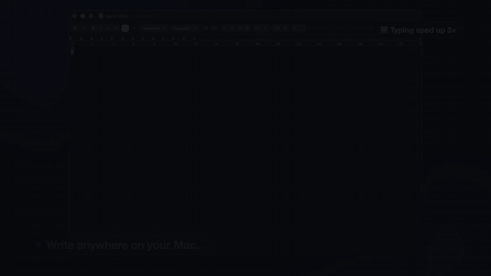

# TextPolish


**Fix the text you select, in any Mac app, with an AI that runs on your Mac.** Select, press **⌥⌘G**, accept the fixes, and the text is pasted back. Nothing leaves your Mac.

<p align="center">
  
</p>

<p align="center"><b><a href="https://enguerrand-roques.github.io/textpolish/textpolish-demo.mp4">▶ Watch the 1-minute video</a></b></p>

| **97 %** | **~1 s** | **0** | **0 bytes** |
|:---:|:---:|:---:|:---:|
| of new sentences corrected right | per sentence | doubtful fixes applied without your click | of your text sent anywhere |

## Install

macOS 13+, Apple Silicon recommended. Paste in Terminal:

```bash
curl -fsSL https://raw.githubusercontent.com/Enguerrand-Roques/textpolish/main/install.sh | bash
```

It installs what is missing and opens TextPolish. A setup window then downloads the model (3.3 GB, once) and asks for the Accessibility permission. No administrator password; [read the script](install.sh) first if you like.

## What it does

- **Correction** (default): fixes spelling, accents, grammar and agreement, and labels each fix. A fix it isn't sure about is shown in orange and waits for your click.
- **Pro** (⌘2): rewrites the message for work. **Custom** (⌘3): your own request, like "translate into French" or "make it shorter".
- English and French, in the text and in the interface. Open at Login, history and shortcut from the ✏️ menu.

## How the model was made

17 local models were benchmarked on the same sentences; the best one, Gemma 4 E2B, was then **fine-tuned on a MacBook Air** to do exactly this job. Wrong fixes fell from 5 to 2 on 749 test sentences, at the same speed and 1 GB lighter.

→ **[The model: benchmark, fine-tuning, before and after](https://enguerrand-roques.github.io/textpolish/model.html)**

## Learn more

- **[UX case study](https://enguerrand-roques.github.io/textpolish/case-study.html)**: eleven iterations of the window, ten decisions and what each cost.
- **[Benchmark report](benchmarks/BENCHMARK_REPORT.md)**: twelve rounds, every raw result. **[Fine-tuning](finetune/README.md)**: data, scripts, the rule written before training.
- **[Developer guide](DEVELOPMENT.md)**: troubleshooting, install by hand, settings, speed, code layout.
- **[Changelog](CHANGELOG.md)** · **[TextPolish Cloud](https://github.com/Enguerrand-Roques/textpolish-cloud)**, the same tool with Google Gemini.

*A personal project to learn how to build an AI product end to end, and how to measure it. MIT license.*
